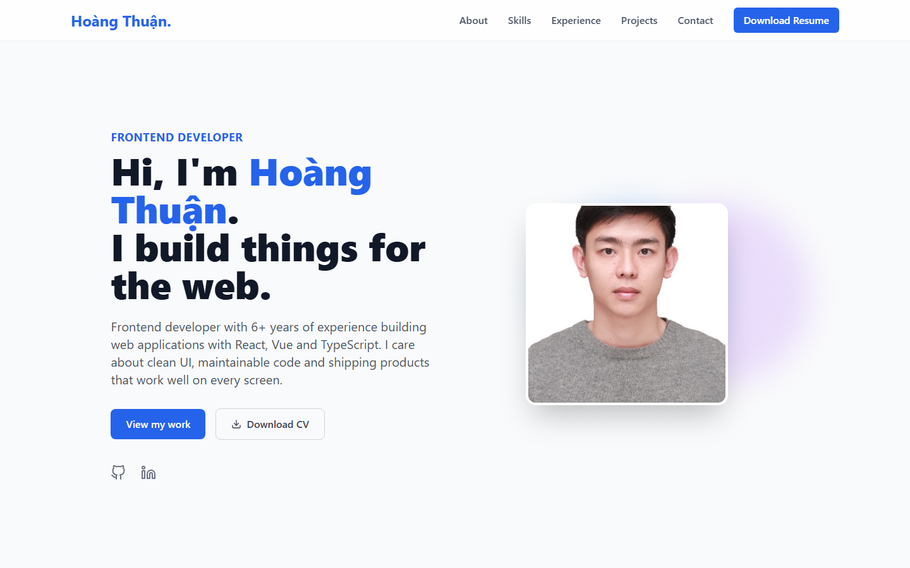

# Portfolio — Hoàng Thuận

My personal portfolio website.

**Live:** https://coolderporfoliodeploy.vercel.app



## Features

- Sections: About, Skills, Work Experience, Projects, Contact
- Content lives in plain data files (`src/data/*.js`), so updating the site means editing data, not components
- Scroll-in animations with Framer Motion
- Responsive layout with a mobile menu
- Downloadable CV

## Tech stack

React 18 · Vite · Tailwind CSS · Framer Motion · React Icons · Vercel

## Getting started

```bash
npm install
npm run dev
npm run build
```

## Project structure

```
src/
├── components/   # ProjectCard
├── data/         # myInfo, skills, experience, projects
└── sections/     # Header, Hero, Skills, Experience, Projects, Contact, Footer
```
